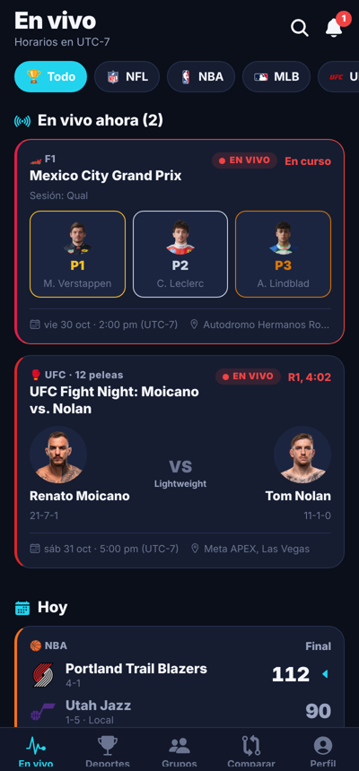
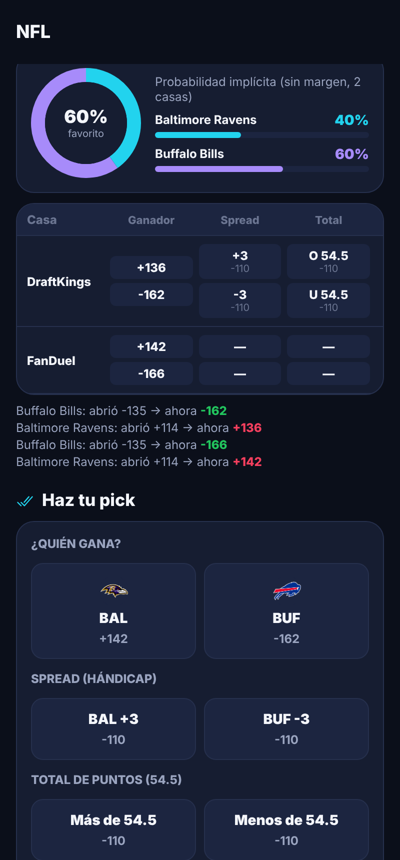
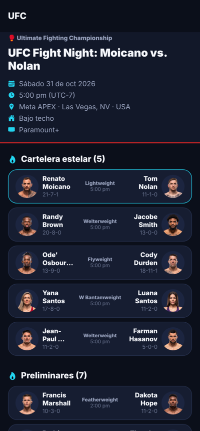
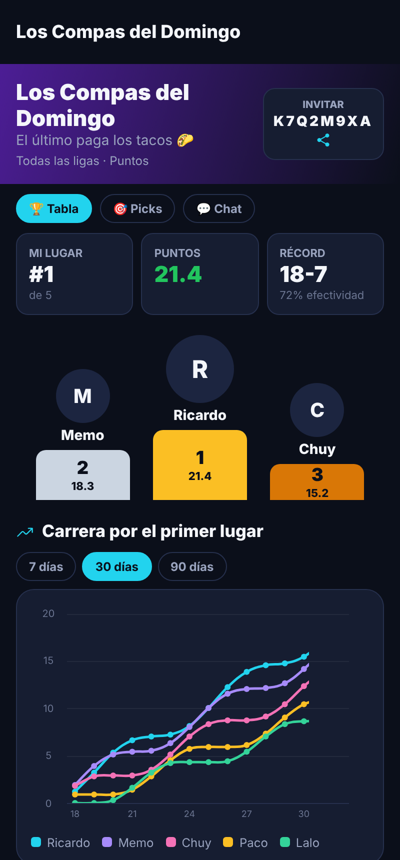
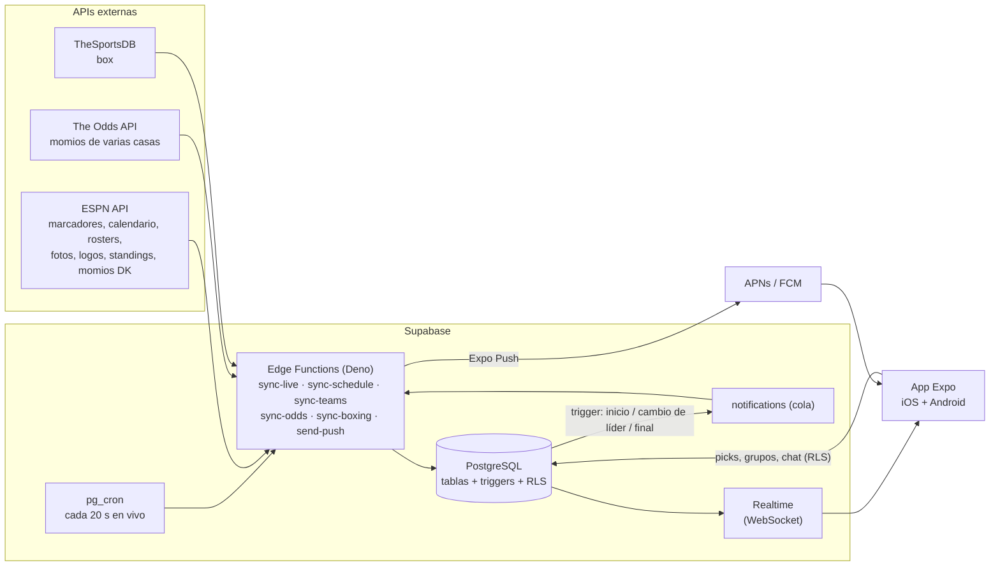

# 🏆 Sports Picks

App móvil (iOS y Android) de deportes con **marcadores en vivo**, estadísticas, momios de casas de apuestas y **grupos de picks entre amigos**, con **notificaciones push**.

Ligas: **NFL · NBA · MLB · UFC/MMA · Box · Fórmula 1**

| Inicio en vivo | Juego + momios | Cartelera UFC | Grupo de picks |
|---|---|---|---|
|  |  |  |  |

> Capturas generadas con datos reales de ESPN (31 oct 2026): GP de México en vivo, UFC Fight Night, NFL con momios de DraftKings.

---

## 1. Arquitectura



**Por qué Supabase (PostgreSQL)** — responde a *“¿cómo agregamos la base de datos?”*:

1. **Realtime nativo**: cada vez que cambia un marcador en la tabla `competitions`/`competitors`, Supabase lo empuja por WebSocket a todos los celulares conectados. No hay que construir un servidor de sockets.
2. **Lógica en la base de datos** (triggers): cuando un juego pasa a `live` o `final`, Postgres **califica los picks automáticamente** y **encola notificaciones**. Es imposible que un juego termine sin calificarse, aunque la app esté cerrada.
3. **Seguridad por fila (RLS)**: cada usuario solo ve sus grupos; los picks de los demás se **revelan hasta que inicia el juego** (anti-copia); nadie puede marcar su pick como ganado.
4. **Auth incluida** (correo/contraseña; se puede agregar Apple/Google), **Edge Functions** para sincronizar APIs y **pg_cron** para programarlas.
5. Escala a miles de usuarios y grupos; plan gratuito para empezar, Pro (USD 25/mes) para producción.

---

## 2. Base de datos

Migraciones en [`supabase/migrations`](supabase/migrations):

| Archivo | Contenido |
|---|---|
| `…01_schema.sql` | Tablas |
| `…02_logic.sql` | Triggers: bloqueo de picks, calificación, notificaciones en vivo, vistas de tabla/tendencias, comparativos (H2H, forma) |
| `…03_security_realtime.sql` | RLS en todas las tablas + publicación Realtime |
| `…04_cron.sql` | Programación de sincronizaciones |
| `…05_leagues.sql` | Ligas (NFL, NBA, MLB, UFC, Box, F1) |
| `…06_push_queue.sql` | Cola de push concurrente segura |

### Modelo unificado para todos los deportes

```
leagues ─┬─ teams ── athletes (foto, posición, stats, gamelog)
         └─ events (juego / cartelera / Gran Premio, sede, hora)
               └─ competitions (el partido / cada pelea / cada sesión: FP1, Qual, Race)
                     ├─ competitors (equipo o atleta, marcador, ganador, parciales, líderes)
                     ├─ odds (casa, mercado h2h/spread/total, momio, línea, apertura)
                     └─ odds_history (movimiento de línea → gráficos)
standings (clasificación por conferencia/división, campeonato F1)

profiles (zona horaria, preferencias de notificación) ── push_tokens
groups (código de invitación, ligas, puntuación) ── group_members ── group_messages
picks (ganador · spread · total · método de victoria · podio F1) → status/puntos automáticos
notifications (bandeja + cola push) · favorites · sync_runs (monitoreo)
```

### Tipos de pick y puntuación

| Pick | Deportes | Se gana si… |
|---|---|---|
| `winner` | todos | tu equipo/peleador/piloto gana |
| `spread` | NFL/NBA/MLB | tu equipo cubre el hándicap |
| `total` | NFL/NBA/MLB | la suma de puntos queda arriba/abajo de la línea |
| `method` | UFC/Box | aciertas ganador **y** método (KO/TKO, Sumisión, Decisión) |
| `podium` | F1 | tu piloto termina top 3 |

Cada grupo elige **Puntos** (fijos + bonus por underdog) o **Unidades** (como apostador real: un pick a +150 paga +1.5u, perder resta 1u).

### Notificaciones (las genera la BD, no la app)

| Evento | A quién | Ejemplo |
|---|---|---|
| Inicio | usuarios con pick o que siguen al equipo/atleta | 🔴 EN VIVO: BAL vs BUF |
| Cambio de líder (4º cuarto / 7ª entrada en adelante) | usuarios con pick | ⚡ Ravens toma la ventaja · BAL 27 · BUF 24 |
| Pick calificado | dueño del pick | ✅ ¡Pick ganador! +1.4 pts |
| Final | seguidores | 🏁 Final: Volkanovski vs Evloev · KO/TKO R2 |
| Grupo | miembros | Memo se unió al grupo 🙌 |

Las notificaciones tienen `dedupe_key`, así que nunca llegan duplicadas, y respetan las preferencias del perfil.

### Probado

Las migraciones se aplicaron en PostgreSQL 16 y se corrió un escenario completo: dos usuarios, grupo con código, picks, intento de hacer trampa (bloqueado), juego en vivo, cambio de líder, final, calificación automática, tabla y notificaciones.

---

## 3. Fuentes de datos (APIs)

| Fuente | Uso | Costo |
|---|---|---|
| **ESPN** (`site.api.espn.com`) | Calendario, marcadores en vivo, carteleras UFC (estelar/preliminares, método, round), sesiones F1, equipos, rosters, **fotos de jugadores/peleadores/pilotos**, **logos**, clasificación, estadísticas, gamelogs, momios DraftKings | Gratis, no oficial |
| **The Odds API** | Momios de DraftKings, FanDuel, BetMGM, Caesars, etc. | Gratis 500 req/mes; desde USD 30/mes |
| **TheSportsDB** | Box (ESPN no publica scoreboard de boxeo) | Clave gratuita de prueba; Patreon para producción |

> ⚠️ La API de ESPN no es oficial y puede cambiar sin aviso. Para un lanzamiento comercial a gran escala conviene un proveedor con licencia (Sportradar, SportsDataIO, API-Sports). Solo hay que cambiar `supabase/functions/_shared/espn.ts`: el resto del sistema trabaja con el modelo normalizado. Las fotos y logos son propiedad de sus titulares; revisa los términos antes de publicar en las tiendas.

---

## 4. Todo desde GitHub (sin computadora) — uso personal

La app es para uso personal (tú y tus amigos), sin tiendas. Todo se despliega con **GitHub Actions**:

| Workflow | Qué hace | Cuándo corre |
|---|---|---|
| **Supabase** | Sube las Edge Functions y sus secretos; carga inicial; historial; migraciones | Solo al hacer push en `supabase/functions` o a mano |
| **Web (GitHub Pages)** | Publica la app web en `https://ricardosalmeron71-png.github.io/sports-picks/` | Al hacer push en `mobile/` |
| **Android APK** | Compila el APK en la nube de Expo | A mano |

### Paso 1 · Secrets del repositorio
GitHub → **Settings → Secrets and variables → Actions → New repository secret**:

| Nombre | De dónde sale |
|---|---|
| `SUPABASE_ACCESS_TOKEN` | supabase.com → avatar → **Account → Access Tokens → Generate new token** |
| `CRON_SECRET` | SQL Editor: `select decrypted_secret from vault.decrypted_secrets where name = 'cron_secret';` |
| `SUPABASE_DB_PASSWORD` | La contraseña que pusiste al crear el proyecto (solo para "aplicar-migraciones") |
| `EXPO_TOKEN` | expo.dev → **Account settings → Access tokens** (solo para el APK) |
| `ODDS_API_KEY` | (opcional) the-odds-api.com |
| `THESPORTSDB_KEY` | (opcional) thesportsdb.com |

### Paso 2 · Activar GitHub Pages
**Settings → Pages → Build and deployment → Source: GitHub Actions**.

### Paso 3 · Correr los workflows (pestaña **Actions** → elegir workflow → **Run workflow**)
1. **Supabase** → `desplegar-funciones`
2. **Supabase** → `aplicar-migraciones` (marca las 6 que corriste a mano y aplica la 7: momios 2 veces al día para no gastar la cuota gratis)
3. **Supabase** → `carga-inicial` (equipos, fotos, clasificaciones, calendario, box, momios)
4. **Supabase** → `cargar-historial` (UFC/F1 3 años; NFL/NBA/MLB último año → forma reciente, H2H, historial de peleas). Tarda ~20–40 min.
5. **Web (GitHub Pages)** → Run workflow
6. **Android APK** → Run workflow → descargar el APK desde expo.dev → Builds

Revisar que todo jale: SQL Editor → `select job, league_id, ok, items, error from sync_runs order by id desc limit 30;`

### Picks y grupos (uso diario)
- **Pestaña Picks**: NFL por semana, NBA/MLB por día, UFC/Box por cartelera. Eliges al ganador de cada juego y presionas **🔒 Guardar picks**; desde ese momento son **definitivos** (la base de datos no permite editarlos ni borrarlos).
- **Grupo → código de invitación**: botones *Copiar código*, *Copiar link* y *Compartir*. El link (`…/group/join?code=XXXX`) abre la versión web y, si el amigo aún no tiene cuenta, recuerda el código y lo une al grupo al registrarse.

### Cómo la instalan tus amigos
- **Android**: abren el link del APK en el celular e instalan (permitir "orígenes desconocidos").
- **iPhone**: abren `https://ricardosalmeron71-png.github.io/sports-picks/` en **Safari** → Compartir → **Agregar a pantalla de inicio**.

> Notificaciones: en Android requieren un proyecto de Firebase (gratis) cargado en expo.dev → Credentials. En iPhone (web) se están agregando notificaciones web push (iOS 16.4+).

---

## 5. Puesta en marcha manual (alternativa con computadora)

### 4.1 Base de datos y backend

```bash
npx supabase login
```

```bash
npx supabase link --project-ref TU_PROJECT_REF
```

```bash
npx supabase db push
```

En el **SQL Editor** de Supabase, guarda dos secretos en Vault (los usa pg_cron para llamar a las funciones):

```sql
select vault.create_secret('https://TU_PROJECT_REF.supabase.co', 'project_url');
select vault.create_secret('UN-SECRETO-LARGO-ALEATORIO', 'cron_secret');
```

Secretos de las Edge Functions:

```bash
npx supabase secrets set CRON_SECRET=UN-SECRETO-LARGO-ALEATORIO ODDS_API_KEY=tu_clave THESPORTSDB_KEY=tu_clave
```

```bash
npx supabase functions deploy
```

Carga inicial (equipos, rosters con fotos, clasificaciones, calendario e historial de UFC para el historial de peleas):

```bash
curl -X POST https://TU_PROJECT_REF.supabase.co/functions/v1/sync-teams -H "x-cron-secret: UN-SECRETO-LARGO-ALEATORIO"
```

```bash
curl -X POST https://TU_PROJECT_REF.supabase.co/functions/v1/sync-schedule -H "x-cron-secret: UN-SECRETO-LARGO-ALEATORIO" -H "Content-Type: application/json" -d '{"daysBack":2,"daysAhead":45}'
```

```bash
curl -X POST https://TU_PROJECT_REF.supabase.co/functions/v1/sync-schedule -H "x-cron-secret: UN-SECRETO-LARGO-ALEATORIO" -H "Content-Type: application/json" -d '{"leagues":["ufc","f1"],"daysBack":1100,"daysAhead":0}'
```

A partir de ahí todo es automático (ver `…04_cron.sql`):

| Job | Frecuencia |
|---|---|
| `sync-live` | **cada 20 s**, solo si hay juegos en vivo o por empezar |
| `sync-schedule` | cada 3 h (próximos 45 días + momios ESPN) |
| `sync-odds` | cada 30 min (solo ligas con juegos en 36 h) |
| `sync-teams` | diario (logos, rosters, fotos, clasificación, stats) |
| `sync-boxing` | cada 6 h |
| `send-push` | inmediato por trigger + respaldo cada minuto |

Monitoreo: `select * from sync_runs order by started_at desc;`

### 4.2 App móvil

```bash
cd mobile
```

```bash
npm install
```

```bash
cp .env.example .env
```

Llena `EXPO_PUBLIC_SUPABASE_URL` y `EXPO_PUBLIC_SUPABASE_ANON_KEY` (Supabase → Settings → API).

```bash
npx eas-cli@latest init
```

(escribe el `projectId` en `app.json → extra.eas.projectId`, necesario para push)

```bash
npx expo start
```

> Las notificaciones push requieren un **dispositivo físico** y un *development build* (no funcionan en Expo Go ni en simulador iOS).

```bash
npx eas-cli@latest build --profile development --platform all
```

### 4.3 Publicar en App Store y Google Play

1. **iOS**: cuenta Apple Developer (USD 99/año). `eas credentials` genera la llave APNs para push.
2. **Android**: cuenta Google Play (USD 25 único). Sube la cuenta de servicio de FCM v1 con `eas credentials`.
3. Build y envío:

```bash
npx eas-cli@latest build --platform all --profile production
```

```bash
npx eas-cli@latest submit --platform all
```

4. Actualizaciones sin pasar por revisión (solo JS): `npx eas-cli@latest update`.

---

## 6. Estructura

```
supabase/
  migrations/            esquema, triggers, RLS, cron
  functions/
    _shared/espn.ts      cliente + normalizador ESPN (probado con datos reales)
    _shared/ingest.ts    escritura idempotente (solo filas que cambian → Realtime limpio)
    _shared/push.ts      envío Expo Push (APNs + FCM) con reintentos
    sync-live/           marcadores en vivo + resultados UFC (fightcenter)
    sync-schedule/       calendario, resultados, momios ESPN, backfill histórico
    sync-teams/          equipos, logos, rosters con fotos, standings, stats de temporada
    sync-odds/           The Odds API (multi-casa) emparejado por horario y nombres
    sync-boxing/         TheSportsDB
    send-push/           vacía la cola de notificaciones
    athlete-profile/     perfil enriquecido bajo demanda (stats + gamelog), caché 12 h
mobile/                  Expo SDK 58 + Expo Router + React Query + gifted-charts
  src/app/(tabs)/        En vivo · Deportes · Grupos · Comparar · Perfil
  src/app/event/[id]     marcador, parciales, líderes, cartelera, sesiones F1, momios, picks, H2H
  src/app/team/[id]      récord, tendencia, stats de temporada, próximos, roster con fotos
  src/app/athlete/[id]   foto, bio, stats, gráfico por juego, historial de peleas/carreras
  src/app/league/[id]    próximos, resultados, clasificación, equipos/peleadores/pilotos
  src/app/group/[id]     podio, carrera de puntos, efectividad, picks en vivo, chat
  src/lib/realtime.ts    parches en caliente de marcadores vía Supabase Realtime
  src/lib/notifications.ts  permisos, canales Android, token, navegación al tocar
  src/lib/time.ts        horarios en UTC-7 (configurable por usuario)
```

## 7. Verificación

```bash
cd mobile && npx tsc --noEmit
```

```bash
cd supabase/functions && npx deno@2 check */index.ts
```
